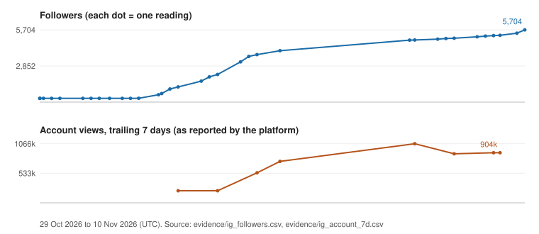

# Agentic Studio

**Sol (Nico) — Solar Nomad** (Upwork: Solar N.). Growth and AI operations: I build small teams of AI agents that do real recurring work, with quality gates, measurements and handover documentation.

This repository is the evidence for that work. Every number below carries a date and a source row in [evidence/README.md](evidence/README.md). The production code lives in a private repository; what is shown here are case studies, aggregate data extracts, runnable samples and sanitized playbooks.

## What the studio is

A multi-agent production setup running on one Mac mini. The Solar Agentic Team: several agent tools (Codex, Hermes, Grok and others) sit in named roles (scout, miner, writer, builder, reviewer, critic, animator). Roles are assigned by benchmark, not by habit; a script dispatches work, falls back to a second tool on quota errors, and logs every call. Nothing is published unless a gate script proves the piece is good.

It currently runs one Instagram account, two content sites, a notes app, a phone control dashboard, and a taste-evaluation project.

## Results (all dated; see evidence index)

| Result | Value | Date range / as of | Evidence |
|---|---|---|---|
| Instagram followers (@solar_list) | **297 to 5,704 in 12 days**, organic only, no ads (owner statement) | 29 Oct 10:19 UTC to 10 Nov 17:36 UTC 2026 | [E1](evidence/README.md#e1), [E17](evidence/README.md#e17) |
| Same, strongest week | 3,179 to 5,704 (+2,525, +79.4%) in 7.2 days | 3 Nov 12:35 UTC to 10 Nov 17:36 UTC 2026 | [E1](evidence/README.md#e1) |
| Account views | **~1.2M views in 12 days (31 Oct - 11 Nov 2026), 98.4% from non-followers**; 796,412 accounts reached (footnote below) | Instagram Insights, owner screenshots 11 Nov 2026 | [E18](evidence/README.md#e18), [E19](evidence/README.md#e19) |
| Account views, trailing 7 days | 903,595 (first logged reading 217,259 on 1 Nov; peak 1,066,326 on 7 Nov) | our log, read 10 Nov 02:33 UTC 2026 | [E2](evidence/README.md#e2) |
| Best single reel | 676,060 views in our log (10 Nov 02:33 UTC); 694K in Insights 30-day view (11 Nov); 5 of 17 tracked reels above 10,000 in our log | 10-11 Nov 2026 | [E3](evidence/README.md#e3), [E18](evidence/README.md#e18) |
| Profile visits / link taps, 7 days | 2,051 / 81 | read 10 Nov 2026 | [E4](evidence/README.md#e4) |
| Search clicks, ashramatlas.com (Google Search Console) | 25 (21-27 Oct) to 73 (2-8 Nov) per 7 days | logged 10 Nov 2026 | [E5](evidence/README.md#e5) |
| Live content site | 42 ashram profiles, 153 URLs in the public sitemap | checked 10 Nov 2026 | [E6](evidence/README.md#e6) |
| Curated video index (gofreealts.com/watch) | 738 videos from 91,670 forum items scanned | built 1 Nov, checked 10 Nov 2026 | [E7](evidence/README.md#e7) |
| Agent seat benchmark | 8 roles x up to 4 tools, scored by deterministic scorers | 9 Nov 2026 | [E8](evidence/README.md#e8) |
| Dispatch log | 346 log lines, 11 automatic fallback runs, 12 failed attempts | 9-10 Nov 2026 | [E9](evidence/README.md#e9) |
| Judge agreement with a human (small samples) | 65.9% on 41 pairs; 72.9% on 24 pairs | 10 Nov 2026 | [E10](evidence/README.md#e10) |
| Automated test suites | 213 (notes app), 16 (reel gates), 12 (metrics), 17 (X tools) | 9-10 Nov 2026 | [E11](evidence/README.md#e11) |
| Reel library | 99 versions of 30 reels tracked | 10 Nov 2026 | [E12](evidence/README.md#e12) |

Method on the Instagram account: niche reels plus scheduled community engagement; 98.2% of the trailing-7-day views came from non-followers (98.5% over 30 days), read 10 Nov 2026 02:33 UTC ([E2](evidence/README.md#e2)). The account owner states that work on the account began in the last week of October at roughly 220 followers, before daily tracking started; that is the owner's account, not measured data.

Footnote: Instagram Insights reports 1,213,825 for its 30-day window; our snapshots show under 10,000 views in that window before 31 Oct (9,367 across 13 items, latest reading per item as of 30 Oct 22:35 UTC; [E19](evidence/README.md#e19)).

Latest follower count seen on the profile: 5,794 on 11 Nov 2026 (owner screenshot). The headline stays our measured series.

Revenue: pre-revenue. These are traffic and process results from the first weeks of the studio, not business results, and the sample sizes are small. I state that on purpose.

## Projects

| Project | One line | Case study |
|---|---|---|
| Content studio | Multi-agent video studio: seats, dispatch, benchmarks, quality gates, animation lab, trial loop | [content-studio](case-studies/content-studio.md) |
| Instagram growth | The @solar_list account: numbers, top reels, how to verify them publicly | [instagram-growth](case-studies/instagram-growth.md) |
| Mission Control | Phone dashboard and control plane for the agents: jobs, metrics, UX gate | [mission-control](case-studies/mission-control.md) |
| Taste brain | A/B taste evaluation and judge calibration, with honest accuracy numbers | [taste-brain](case-studies/taste-brain.md) |
| Ashram Atlas | Sourced directory site, deploy checks, click tracking with bot filter, route-pack product | [ashram-atlas](case-studies/ashram-atlas.md) |
| GoFreeAlts | Free-alternatives site plus a curated video index and indexing checks | [gofreealts](case-studies/gofreealts.md) |
| Hatha Notes | Offline-first notes app with on-device OCR and audio recitation (web + Android beta) | [hatha-notes](case-studies/hatha-notes.md) |
| X engagement loop | Scout, draft, validate, gate and evaluate loop with caps and a kill rule | [x-engagement](case-studies/x-engagement.md) |
| Ops playbooks | Shared agent rules across tools, playbooks, deploy cards, access-library concept | [ops-playbooks](case-studies/ops-playbooks.md) |

## Code samples

Small, self-contained, with self-tests (`python3 file.py` or `node file.mjs`): [samples/](samples/)
- `dispatch_fallback.py` seat dispatch with fallback and usage guard
- `evidence_gate.py` publish gate that treats "not evidenced" as a failure
- `daily_metrics.py` week-over-week, staleness and "what moved" without an AI call
- `apca_contrast.py` perceptual text-contrast gate
- `owner_bot_filter.mjs` click logging that excludes owner and automated traffic
- [playbooks/](samples/playbooks/) two sanitized playbooks

## How I work with clients

1. **Scope.** One written page: the outcome, the numbers that will show it, what is out of scope. I start with the smallest loop that can prove value.
2. **Build.** Agents do the repetitive work; scripts do everything that can be checked deterministically; a person approves what is new. Every step leaves a log, a dated metric or a test.
3. **Handover.** Accounts and credentials stay under your control (I work from access you grant and can revoke). Workflows are editable files, not a black box. You receive documentation, a playbook per workflow and a rollback for anything deployed.

## Contact

- Upwork: https://www.upwork.com/freelancers/~0135ae276a28cbbb93
- LinkedIn: https://www.linkedin.com/in/meetnico

Re-check the numbers yourself: [evidence/README.md](evidence/README.md). Regenerate the chart and figures from the CSV extracts: `python3 scripts/derive_ig_metrics.py report`.
