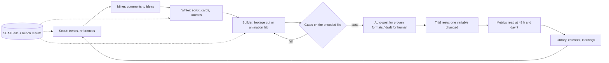

# Content studio: a multi-harness agent team for short video

[Back to overview](../README.md)

## Problem
Short-video accounts need a steady flow of pieces that are factually right, readable on a phone and on-brand. One chat assistant doing everything gives uneven quality and burns one tool's quota. The goal: a repeatable pipeline where each step is done by the cheapest tool that benchmarks well, and where a script, not a mood, decides whether a piece ships.

## System built
Roles ("seats") are assigned to agent tools by measurement. A dispatcher runs the seat's tool, falls back once on a quota error, and skips a hot quota pool through a usage guard. Pieces pass deterministic gates before a human or an auto-post rule sees them.

- **Seats and dispatch:** one file maps role to tool, model, fallback, effort and per-task cap; a seat changes only on a benchmark result or a quota incident. See [samples/dispatch_fallback.py](../samples/dispatch_fallback.py).
- **Benches:** per role, a task set and a deterministic scorer, run across the Solar Agentic Team's adapters (Codex, Hermes, Grok and others).
- **Quality gates** (on the encoded video): card legibility (perceptual contrast floor by size and weight, [sample](../samples/apca_contrast.py)), card-to-voice sync, platform safe zones, text fitting, motion QC for animated beats, sourced-facts table, own-work share and credits, cover wording, and an autopost gate that treats missing evidence as a failure ([sample](../samples/evidence_gate.py)).
- **Animation lab:** a Remotion-based kit that reads style tokens, a shot-spec JSON written by the director, and a script that renders and measures every beat (events per 2.5 s, route overlap, label overlap).
- **Trial-reel loop:** one thesis per test, one variable changed (cover, first 3 s, narration, music, lettering, length), variants gated like any piece, results read back into the format rules.
- **Library and calendar:** every version of every reel is registered with its gate result; a calendar page exports planned items.

## Evidence
- Benchmark, 9 Nov 2026: 8 roles scored across 4 tools. Examples from the scorer table: writer 0.94 on three tools; builder 1.00 on three tools and 0.67 on the fourth (its failed task was an adapter permission issue, not a model score); scout 1.00 on two tools. Seats moved on these results (writer and miner to the cheaper tool). [E8](../evidence/README.md#e8)
- Dispatch log, 9-10 Nov 2026: 346 log lines; 11 fallback runs; 12 failed attempts. [E9](../evidence/README.md#e9)
- Gate test suite: 16/16 checks pass (run 10 Nov 2026). [E11](../evidence/README.md#e11)
- Library: 99 versions of 30 reels registered. [E12](../evidence/README.md#e12)
- Animation lab: two animated beats rendered with all motion checks passing (9 Nov 2026).
- Status, stated plainly: the autopost gate is built and tested, and its switch is currently off; reels so far were reviewed or posted by a person. The trial-reel loop is built and tested offline; no trial results exist yet.

## What I would do for a client
Start from your one repeatable content format, write the gates for it first (what "good" means in numbers), then assign tools by a one-day benchmark on your own tasks. Deliver the seats file, the gate scripts, the playbook and a weekly metrics digest. You keep the accounts and the repository.
