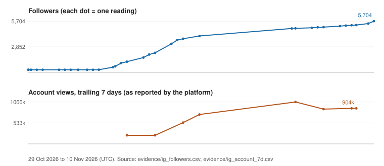

# Instagram growth: @solar_list

[Back to overview](../README.md)

## Problem
A new travel and temples account with 297 followers at the first logged reading (29 Oct 2026). The account owner states that work on it began in the last week of October at roughly 220 followers, before daily tracking started; that is the owner's account, not measured data. Goal: find a format that reaches non-followers, and prove it with numbers a stranger can check.

## System built
Map-style reels ("5 temples, 1 map") made through the [content studio](content-studio.md): researched facts with sources, rendered maps, readable cards, a cover that says what the piece is. Metrics are read on a schedule into CSV logs; a script builds a daily digest ([sample](../samples/daily_metrics.py)); niche reels are paired with scheduled community engagement, with no paid promotion according to the account owner; a format counts as "proven" only after a rule is met (at least 2 posts above 10x the account's median views, or at least 10 sends per 1,000 views).

## Evidence
All figures re-derived from the CSV extracts in [evidence/](../evidence/) by `python3 scripts/derive_ig_metrics.py report`.

| Figure | Value | Range / as of (UTC) |
|---|---|---|
| Followers | **297 (29 Oct 10:19) to 5,704 (10 Nov 17:36)**, organic, no ads (owner statement) | 12.3 days; 298 on 30 Oct, 301 on 31 Oct 22:35, 1,197 on 1 Nov, 3,179 on 3 Nov |
| Followers, strongest week | 3,179 (3 Nov 12:35) to 5,704 (10 Nov 17:36): +2,525, +79.4% | 7.2 days |
| Account views, trailing 7 days | 903,595 | read 10 Nov 02:33; first logged 217,259 on 1 Nov; peak 1,066,326 on 7 Nov 19:28 |
| Profile visits / link taps, 7 days | 2,051 / 81 | read 10 Nov 02:33 |

Note on one figure: the studio's own daily digest (generated 10 Nov 17:10 UTC) shows 5,671 followers; the log's later reading at 17:36 UTC is 5,704. Both are real readings, 26 minutes apart. Readings are not evenly spaced (some days have none), so the chart shows dots, not a smooth curve.

Top reels by views (latest reading per reel, 10 Nov 2026 02:33 UTC):

| Reel | Posted | Views |
|---|---|---|
| [DfKz1XmKcVf](https://www.instagram.com/reel/DfKz1XmKcVf/) | 31 Oct | 676,060 |
| [DfQxAzvKcMC](https://www.instagram.com/reel/DfQxAzvKcMC/) | 3 Nov | 237,643 |
| [DfNUw4zKNG7](https://www.instagram.com/reel/DfNUw4zKNG7/) | 1 Nov | 150,027 |
| [DfPlw6xqLaI](https://www.instagram.com/reel/DfPlw6xqLaI/) | 2 Nov | 75,552 |
| [DfhZTstlVFf](https://www.instagram.com/reel/DfhZTstlVFf/) | 9 Nov | 21,726 |

5 of 17 tracked reels are above 10,000 views. The rest are in the low thousands or below, so the result is concentrated in a few pieces; I treat "map" reels as a working hypothesis, not a guarantee. 98.2% of the trailing-7-day views came from non-followers (98.5% over 30 days; account insight, read 10 Nov 02:33 UTC).

## How a client can verify
- Public: open the [profile](https://www.instagram.com/solar_list/) and compare the follower count and each reel's public view counter with the CSV. Counters will be higher than the dated rows; that is expected.
- Dated rows: `evidence/ig_followers.csv`, `ig_account_7d.csv`, `ig_reels_latest.csv` (aggregates only, no audience data).
- Platform insight screens (the 7-day views, visits and taps) are private to the account; on an engagement I would show them on a screen share or add you as a viewer.
- No reel videos are stored in this repository.

## What I would do for a client
Pick one format, define the proof rule up front, log metrics to a CSV from day one, and report weekly with the source of each number. Start with 2-3 pieces per week and a hypothesis per piece rather than volume.
